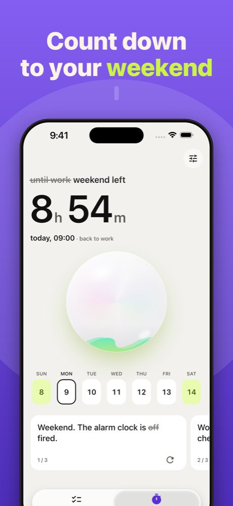
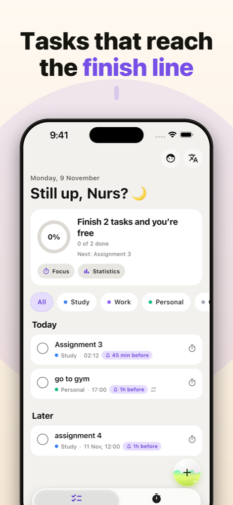
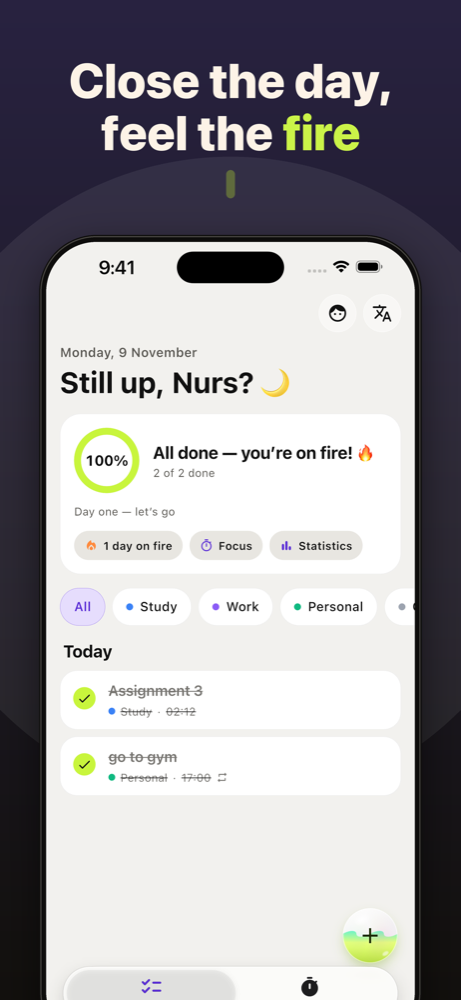
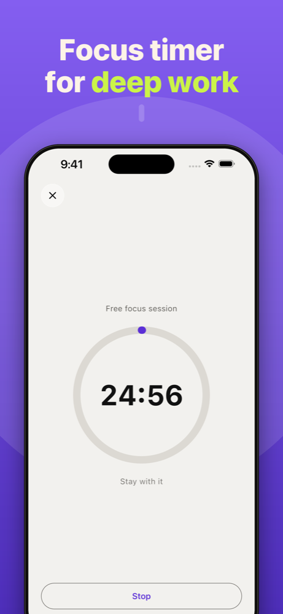
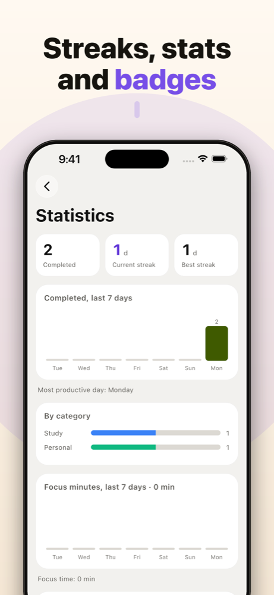
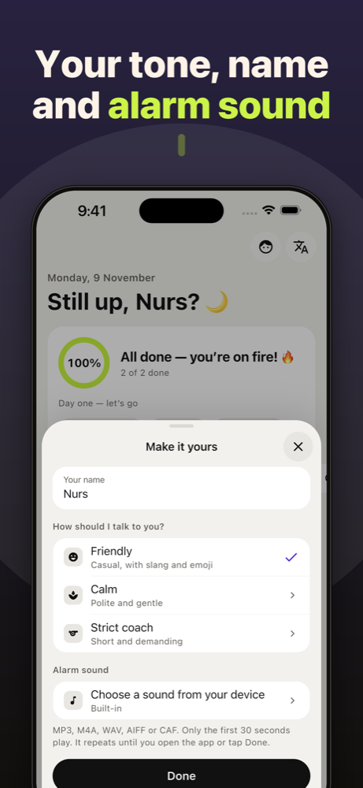

# Umytpa

Task tracker and weekend timer for iOS and Android. Tasks, reminders, alarms and a live countdown to your days off. Offline-first: all data stays on your device, no account needed.

<p align="center">
  
  
  
</p>
<p align="center">
  
  
  
</p>

## Features

- **Weekend countdown** with a live timer to your next day off, a week strip and country holidays.
- **Tasks** with categories, due dates, repeats and reminders ("45 min before", "1h before").
- **Real alarms** on iOS 26 (AlarmKit) and a custom alarm sound (MP3, M4A, WAV, AIFF, CAF).
- **Focus timer** for deep work sessions.
- **Streaks, statistics and badges.**
- **Personal tone**: friendly, calm or strict coach.
- **Localization**: English and Russian.
- Home screen widget.

## Tech stack

Flutter, `flutter_bloc`, `go_router`, `get_it`, Drift (SQLite), `flutter_local_notifications`, `home_widget`.

## Getting started

```bash
flutter pub get
dart run build_runner build --delete-conflicting-outputs
flutter gen-l10n
flutter run
```

Requires Dart SDK ^3.12.2. Run tests with `flutter test`.

## Links

- [Support](https://nu2su1tan.github.io/umytpa/)
- [Privacy Policy](https://nu2su1tan.github.io/umytpa/privacy.html)
